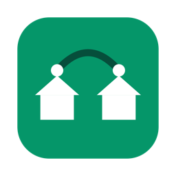

<p align="center">
  
</p>

<h1 align="center">SiteLink</h1>

Un interruttore, come una VPN, per il collegamento site-to-site tra due reti (per esempio ufficio e casa).
Ogni rete ha un router/VM che instrada verso l'altra (per esempio con Tailscale subnet router); SiteLink
accende e spegne il collegamento dal Mac, da Windows o dall'iPhone, senza aprire un terminale.

```
 Mac / PC / iPhone ──HTTP+token──▶ agent (router A) ◀──── peer ────▶ agent (router B)
                                        │                                  │
                                  VPN / Tailscale  ◀══════ tunnel ═══════▶ VPN / Tailscale
```

| Parte | Cartella | Cosa fa |
|---|---|---|
| **Agent** | `agent/` | Servizio sui due router: espone l'API e accende/spegne la VPN con comandi fissi. |
| **Mac** | `mac/` | App nella barra dei menu: pulsante ON/OFF, riconosce la sede, aggiunge/toglie la route. |
| **Windows** | `windows/` | App nella tray, stesso wizard e stessa logica del Mac. |
| **iPhone** | `ios/` | App SwiftUI che parla solo con gli agent; azioni per Comandi rapidi. |

Ogni cartella ha un suo `README.md` con i dettagli (`windows/`, `ios/`). Questo è il quadro completo.

## Come funziona

- **Agent**: Python 3 (solo libreria standard), utente non-root `sitelink`, servizio systemd. Accetta solo
  richieste con `Authorization: Bearer <token>` e esegue solo azioni predefinite (mai una shell).
- **Accendere** = agent locale (annuncia le route / avvia la VPN) → route sul computer → agent dell'altra
  sede (tramite il *peer*). **Spegnere** = l'inverso, così il canale verso l'altra sede c'è finché serve.
- **Computer (Mac/Windows)**: stando nella rete di una sede, l'app sa dove si trova (dal proprio IP) e
  aggiunge una route statica verso l'altra rete passando dal router locale. Serve un'autorizzazione
  amministratore **una sola volta**, poi nessuna password a ogni clic.
- **iPhone**: non modifica nessuna route; chiede agli agent di accendere/spegnere. Basta raggiungere un agent.
- **Stato**: *Connesso* (agent e route attivi), *Disconnesso*, *Parziale* (arancione), *Sconosciuto*.

### API dell'agent (v2)

| Richiesta | Auth | Risposta |
|---|---|---|
| `GET /health` | no | `{"ok": true}` |
| `GET /status` | sì | `api_version`, `site`, `link_enabled`, `vpn{type,up,…}`, `advertised_routes`, `accept_routes`, `expected_routes`, `ping`, `time` |
| `POST /enable`, `POST /disable` | sì | come `/status` dopo l'azione |
| `GET /peer/status`, `POST /peer/enable`, `POST /peer/disable` | sì | inoltra all'agent dell'altra sede (URL e token fissi nella config) |

Gli agent v1 (campo `tailscale` al posto di `vpn`) funzionano ancora con le app.

---

## Prima di tutto: i due router

Servono, per ciascuna sede, un router/VM Linux sempre acceso nella LAN con:

- inoltro IP attivo (`net.ipv4.ip_forward=1`);
- Tailscale installato, collegato, con la rete della sede annunciata come subnet route
  (`tailscale up --advertise-routes=…`) e approvata nella console Tailscale;
- sul router di **una** delle due sedi, se l'altra rete non conosce la rotta di ritorno, un **SNAT**
  (masquerade) verso la LAN, come fatto sul Raspberry. Alternativa: rotta statica sul router di casa.

Verifica rapida dal router: `ping` verso un host dell'altra LAN deve rispondere con la VPN accesa.

## 1. Agent (sui due router)

Dal Mac, con accesso SSH e `sudo` sui router:

```bash
cd agent
./deploy.sh utente@10.0.1.31 config.example.json            # ufficio (Ubuntu)
./deploy.sh utente@10.0.2.2 config.raspberry.example.json     # casa (Raspberry)
```

`deploy.sh` copia i file, genera un **token casuale** per quel router e installa il servizio.
**Il token compare alla fine: copialo** (ogni router ha il suo; sta anche in `/etc/sitelink/agent.json`).

Poi, **su ciascun router**, collega i due agent tra loro (peer) con l'indirizzo Tailscale dell'altro:

```bash
tailscale ip -4                                         # sull'altro router: annota l'IP 100.x.y.z
sudo /opt/sitelink/set-peer.sh http://100.x.y.z:8765    # chiede il token dell'altro (non viene mostrato)
```

Controllo (dal Mac, nella rete di quella sede):

```bash
curl http://10.0.1.31:8765/health
curl -H "Authorization: Bearer TOKEN" http://10.0.1.31:8765/status
curl -H "Authorization: Bearer TOKEN" http://10.0.1.31:8765/peer/status   # stato dell'altra sede, via peer
```

### Config dell'agent (`/etc/sitelink/agent.json`)

| Campo | Significato |
|---|---|
| `site_name` | Nome della sede (compare in `/status`). |
| `token` | Almeno 24 caratteri; autentica le richieste. |
| `listen` | Dove ascoltare: IP della LAN, `"tailscale"` (IP Tailscale, riletto ogni 30 s) o `"iface:NOME"`. |
| `port` | Default 8765. |
| `advertise_routes` | Reti da annunciare quando il collegamento è acceso. |
| `remote_ping_target` | IP dell'altra sede usato per il test di raggiungibilità. |
| `peer` | `{"url": "http://IP:8765", "token": "…"}` (lo imposta `set-peer.sh`). |
| `backend` | `"tailscale"` (default) oppure `"command"`. |
| `commands` | Solo con `command`: tre liste di argomenti fissi `status`, `enable`, `disable`. |

Dopo ogni modifica: `sudo systemctl restart sitelink-agent`. Log: `journalctl -u sitelink-agent -f`.

### Senza Tailscale (backend `command`)

L'agent non è legato a Tailscale: con `"backend": "command"` esegue tre comandi fissi, per esempio per
WireGuard (`agent/config.wireguard.example.json`). Lo stato è "acceso" se il comando `status` esce con 0.

```bash
./deploy.sh utente@host config.wireguard.example.json
```

I comandi che richiedono root usano `sudo -n`: serve una regola sudoers per l'utente `sitelink`, solo per i
comandi esatti, per esempio in `/etc/sudoers.d/sitelink-agent`:

```
sitelink ALL=(root) NOPASSWD: /usr/bin/systemctl start wg-quick@wg0, /usr/bin/systemctl stop wg-quick@wg0
```

L'installer, con questo backend, disattiva `NoNewPrivileges` per il servizio (altrimenti `sudo` non funziona).
In `listen` usa un'interfaccia raggiungibile dai client (`iface:wg0` o l'IP LAN).

### Problemi dell'agent

| Sintomo | Causa / rimedio |
|---|---|
| `deploy.sh: no such file` | Lancialo dalla cartella `agent/` o con il percorso completo. |
| Il servizio non parte | `journalctl -u sitelink-agent -n 50`: config non valida (token < 24 caratteri, IP in `listen` inesistente, JSON rotto). |
| `curl` non risponde | IP/porta errati, firewall, o il router non ascolta su quell'indirizzo: `ss -ltnp \| grep 8765`. |
| `401 unauthorized` | Token sbagliato (ogni router ha il suo). |
| `/peer/status` → 501 | Peer non configurato: esegui `set-peer.sh`. |
| `/peer/status` → errore | L'altro agent non risponde o ha un altro token; prova `curl` all'IP Tailscale dell'altro. |
| Acceso ma niente ping | Subnet route non approvata in Tailscale, `ip_forward` spento, o manca il SNAT/rotta di ritorno. |
| `/status` mostra `ping.reachable:false` | Normale a collegamento spento; da acceso controlla le route e il peer. |
| Cambio IP Tailscale | Riesegui `set-peer.sh` sull'altro router con il nuovo IP. |

---

## 2. Mac

**Installazione**
1. Apri `mac/dist/SiteLink.dmg` e trascina **SiteLink** in **Applicazioni**. (Per rigenerarlo: `mac/make-dmg.sh`; serve Xcode.)
2. Primo avvio: l'app non è firmata, quindi macOS la blocca. Impostazioni di Sistema → Privacy e sicurezza →
   **Apri comunque** (o clic destro sull'app → Apri). Se vedi "danneggiata":
   `xattr -dr com.apple.quarantine /Applications/SiteLink.app`
3. Si apre la **configurazione guidata** (3 passi): per ogni sede nome, rete (`10.0.1.0/24`), IP del router
   con l'agent e token; poi una prova di connessione.
4. Salvando, macOS chiede la **password amministratore una volta**: installa `/etc/sudoers.d/sitelink` con i soli
   comandi `route add/delete` esatti per le due reti. Lo stesso si può fare da terminale: `sudo mac/install-routes.sh`.
5. L'icona (casa + arco) è nella barra dei menu: clic = pannello con il pulsante ON/OFF.

**Uso**: sei in una delle due reti e premi il pulsante. L'app aggiorna lo stato ogni 10 s e, se il collegamento
è acceso e la route sparisce (cambio rete, riavvio), la rimette da sola.

**Config**: `~/Library/Application Support/SiteLink/config.json` (formato in `mac/config.example.json`; contiene i
token, permessi 600). Si può cambiare da **Impostazioni…** nel pannello.

| Sintomo | Causa / rimedio |
|---|---|
| Non vedo l'icona | Barra dei menu piena (Mac con notch): chiudi altre icone. Controlla in Monitoraggio Attività. |
| "Rete non riconosciuta" | Il Mac non ha un IP in nessuna delle due reti (Wi-Fi diverso, VPN). |
| "Agent … non raggiungibile" | IP/porta/token errati, agent spento, o macOS ha negato "Rete locale": Impostazioni → Privacy → Rete locale → SiteLink. |
| Pulsante grigio + "Autorizza…" | Permessi route mancanti: premi **Autorizza…**. Da rifare se cambi reti o gateway. |
| ON ma niente ping | Se sul Mac c'è **Tailscale** attivo, le sue route possono coprire quelle di SiteLink: esci da Tailscale sul Mac (SiteLink non ne ha bisogno). Controlla con `netstat -rn \| grep 10.0`. |
| Stato "Parziale" | Agent e route non concordano (per esempio route rimasta): premi Aggiorna o riaccendi/spegni. |
| Spento ma la sede resta "attiva" | L'altro agent non ha risposto: guarda il messaggio sotto il pulsante; controlla il peer (sezione agent). |
| Disinstallare | Elimina l'app, `~/Library/Application Support/SiteLink` e `sudo rm /etc/sudoers.d/sitelink`. |

## 3. Windows

**Installazione**: avvia `windows/dist/SiteLink-Setup.exe` (installa solo per il tuo utente in
`%LOCALAPPDATA%\Programs\SiteLink`, nessun amministratore; collegamenti e avvio automatico opzionali).
SmartScreen avvisa perché non è firmato: **Ulteriori informazioni → Esegui comunque**.
Al primo avvio parte il wizard (stessi campi del Mac). Salvando, **UAC una sola volta** crea 4 attività
pianificate (cartella `SiteLink`) che eseguono solo i comandi `route add/delete` esatti. Serve un account
amministratore. Config: `%APPDATA%\SiteLink\config.json` (stesso formato del Mac).

| Sintomo | Causa / rimedio |
|---|---|
| "Rete non riconosciuta" / "Agent … non raggiungibile" / "token non valido" | Come sul Mac. |
| Pulsante grigio + "Autorizza…" | Premi **Autorizza…** e conferma l'UAC. |
| Una finestra nera lampeggia | È `route.exe`: normale. |
| ON ma niente ping | `route print -4`: cerca la rete dell'altra sede col gateway del router locale. Verifica di non avere un'altra VPN sul PC. |
| Disinstallare | Impostazioni → App → App installate → SiteLink (chiede se eliminare config e attività). |

Compilare: `windows\build.ps1` (Windows, SDK .NET 8) oppure `windows/build.sh` (Mac/Linux) → `dist/SiteLink-Setup.exe`.

## 4. iPhone

**Installazione** (da Xcode, `ios/SiteLink.xcodeproj`): Signing & Capabilities → scegli il tuo Team (Apple ID
gratuito: l'app scade dopo 7 giorni), cambia il Bundle Identifier se serve, collega l'iPhone con Modalità
sviluppatore attiva e premi Run. Se l'app non si apre: Impostazioni → Generali → VPN e gestione dispositivi → Fidati.
Accetta il permesso **Rete locale**.

**Configurazione**: stesso wizard; in più un **indirizzo alternativo** per sede (l'IP Tailscale del router,
`tailscale ip -4`) per quando non sei nelle due reti, e **Importa da config.json** (AirDrop dal Mac → File → Importa;
poi cancella il file perché contiene i token). I token stanno nel Keychain.

**Comandi rapidi**: app Comandi → SiteLink: *Imposta il collegamento*, *Inverti il collegamento*,
*Stato del collegamento*; utilizzabili con Siri e nelle automazioni.

| Sintomo | Causa / rimedio |
|---|---|
| "Nessun agent raggiungibile" | Non sei nella rete di una sede e non c'è l'indirizzo alternativo: attiva Tailscale sull'iPhone e inserisci gli IP 100.x. |
| Errore anche sul Wi-Fi giusto | Impostazioni → SiteLink → **Rete locale** attivo; prova `http://IP:8765/health` da Safari. |
| "token non valido" | Token diverso da quello dell'agent: ingranaggio → reinseriscilo. |
| Pulsante grigio | Nessun agent raggiungibile direttamente. |
| L'app smette di aprirsi dopo 7 giorni | Limite dell'Apple ID gratuito: reinstalla da Xcode. |
| Un comando rapido dice "non configurato" | Apri l'app una volta e completa il wizard. |

---

## Sicurezza

- Il token è l'unica protezione dell'API: lungo (32 byte esadecimali) e diverso per ogni router. Non
  condividere `config.json` né le schermate con i token.
- L'API è HTTP semplice: va bene sulla LAN e sul tunnel Tailscale (cifrato). Non esporla su Internet.
- L'agent esegue solo azioni predefinite con argomenti fissi, mai una shell, con un utente senza privilegi.
- Sui computer, l'autorizzazione delle route (sudoers / attività pianificate) vale solo per i comandi esatti
  delle due reti configurate.
- Per cambiare un token: modifica `/etc/sitelink/agent.json`, riavvia l'agent e aggiorna le app (e il `peer` dell'altro agent).

## Pubblicare il software

Le app non sono firmate. Per distribuirle ad altri senza avvisi:
- **Mac**: account Apple Developer, firma con Developer ID e notarizzazione del DMG.
- **Windows**: certificato di firma del codice (altrimenti SmartScreen avvisa).
- **iPhone**: TestFlight o App Store (Apple Developer Program a pagamento).
Prima di pubblicare, rimuovi dalle cartelle ogni `config.json` reale e usa solo i file `*.example.json`.

## Prove automatiche

```bash
agent/tests/run_local_test.sh        # agent: backend, peer, errori (agent finti in locale)
ios/tests/run_logic_test.sh          # logica dell'app iPhone contro due agent in locale
dotnet run --project windows/tests   # logica Windows (CIDR, route, attività, client agent)
```

## Licenza

Distribuito con licenza MIT: vedi [LICENSE](LICENSE). © 2026 Francesco Argento.
